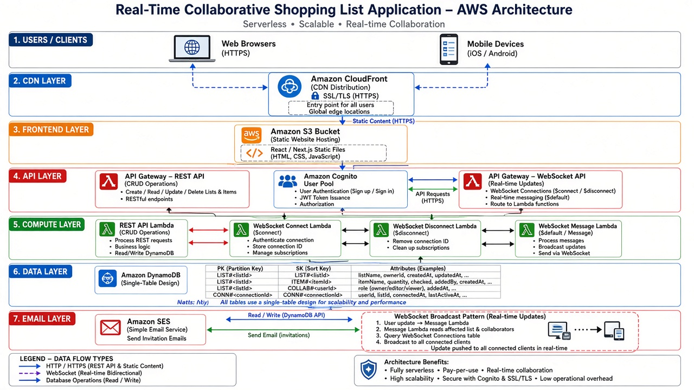

# ShopTogether - Architecture Documentation



## Table of Contents
1. [Overview](#overview)
2. [System Architecture](#system-architecture)
3. [AWS Services](#aws-services)
4. [Data Flow](#data-flow)
5. [Database Schema](#database-schema)
6. [API Endpoints](#api-endpoints)
7. [Real-time Communication](#real-time-communication)
8. [Security](#security)
9. [Scalability](#scalability)

---

## Overview

**ShopTogether** is a real-time collaborative list-sharing application that allows users to:
- Create and manage shopping lists
- Share lists via email invitations
- Collaborate in real-time with live updates
- Access lists across multiple devices

### Architecture Style
- **Serverless**: No server management required
- **Event-driven**: Real-time updates via WebSockets
- **Fully managed AWS services**: High availability and scalability

---

## System Architecture

### 1. Users / Clients Layer
- **Web Browsers**: Desktop users accessing via HTTPS
- **Mobile Devices**: iOS/Android users (future: native apps)
- All traffic goes through CloudFront for optimal performance

### 2. CDN Layer - Amazon CloudFront
- **Purpose**: Content delivery and SSL/TLS termination
- **Configuration**:
  - SSL/TLS certificates via AWS Certificate Manager
  - Single entry point for all users
  - Caches static content (S3)
  - Routes API requests to API Gateway
- **Benefits**:
  - Global edge locations for low latency
  - DDoS protection via AWS Shield
  - Reduced origin load

### 3. Frontend Layer - Amazon S3
- **Purpose**: Static website hosting
- **Contents**:
  - React/Next.js compiled static files
  - HTML, CSS, JavaScript bundles
  - Images and assets
- **Configuration**:
  - Static website hosting enabled
  - Public read access via CloudFront only
  - Versioning enabled for rollback capability

### 4. API Layer

#### Amazon API Gateway - REST API
- **Purpose**: Handle CRUD operations
- **Endpoints**: Lists, Items, Sharing, User management
- **Features**:
  - Request validation
  - Response transformation
  - Throttling and rate limiting
  - Cognito authorizer integration

#### Amazon API Gateway - WebSocket API
- **Purpose**: Real-time bidirectional communication
- **Routes**:
  - `$connect`: New client connection
  - `$disconnect`: Client disconnection
  - `$default`: Default message handler
  - Custom routes for subscribe/unsubscribe
- **Features**:
  - Persistent connections
  - Low-latency message delivery
  - Automatic reconnection support

#### Amazon Cognito User Pool
- **Purpose**: User authentication and authorization
- **Features**:
  - Sign up / Sign in
  - Email verification
  - Password reset
  - JWT token issuance
  - MFA support (optional)

### 5. Compute Layer - AWS Lambda

#### REST API Lambda
- **Purpose**: Process REST API requests
- **Functions**:
  - Create/Read/Update/Delete lists
  - Manage list items
  - Generate share tokens
  - Process invitations
- **Runtime**: Node.js 18+ or Python 3.11+
- **Memory**: 512-1024 MB
- **Timeout**: 10-30 seconds

#### WebSocket Connect Lambda
- **Purpose**: Handle new WebSocket connections
- **Actions**:
  - Authenticate connection (JWT validation)
  - Store connection ID in DynamoDB
  - Initialize subscription metadata

#### WebSocket Disconnect Lambda
- **Purpose**: Clean up disconnected clients
- **Actions**:
  - Remove connection ID from DynamoDB
  - Clean up subscription records

#### WebSocket Message Lambda
- **Purpose**: Process WebSocket messages
- **Actions**:
  - Subscribe to list updates
  - Unsubscribe from lists
  - Broadcast updates to all subscribers
  - Handle default messages

### 6. Data Layer - Amazon DynamoDB

**Single-Table Design** for optimal performance:

#### Primary Table Structure
```
PK (Partition Key)          SK (Sort Key)               Attributes
LIST#<listId>              METADATA                    title, ownerId, createdAt, type
LIST#<listId>              ITEM#<itemId>               name, quantity, checked, addedBy
LIST#<listId>              COLLAB#<userId>             email, role, permissions
USER#<userId>              LIST#<listId>               accessLevel, joinedAt
TOKEN#<token>              METADATA                    listId, email, expiresAt
CONN#<connectionId>        METADATA                    userId, connectedAt, ttl
CONN#<connectionId>        SUB#<listId>                subscribedAt
```

#### Global Secondary Indexes (GSI)
1. **UserListsIndex**: 
   - PK: `userId`
   - SK: `lastAccessedAt`
   - Purpose: Query all lists for a user

2. **TokenIndex**:
   - PK: `token`
   - Purpose: Fast token lookup for invitations

#### DynamoDB Streams
- **Purpose**: Trigger Lambda for broadcasting updates
- **Configuration**:
  - NEW_AND_OLD_IMAGES
  - Trigger on INSERT, MODIFY events
  - Fan-out updates to WebSocket connections

### 7. Email Layer - Amazon SES

**Purpose**: Send invitation emails
- **Configuration**:
  - Verified sender email/domain
  - HTML email templates
  - Bounce and complaint handling
- **Email Types**:
  - List invitation emails
  - Collaboration notifications
  - Welcome emails

---

## Data Flow

### Creating a List
```
User → CloudFront → API Gateway (REST) → Lambda → DynamoDB
                                                      ↓
                                                   Response ← ← ← ← ←
```

### Real-time Updates (WebSocket Broadcast)
```
User A updates item
    ↓
CloudFront → API Gateway (REST) → Lambda → DynamoDB (write)
                                              ↓
                                         DynamoDB Stream
                                              ↓
                                    WebSocket Lambda (triggered)
                                              ↓
                            Query all connections for this list
                                              ↓
        API Gateway WebSocket → Push to User B, User C, User D (real-time)
```

### Sharing a List via Email
```
User → API Gateway → Lambda → Generate token → Store in DynamoDB
                         ↓
                       SES → Send email with invitation link
                                      ↓
                           Recipient clicks link → Accept invitation page
                                      ↓
                             Lambda validates token → Add collaborator
```

---

## Database Schema

### Lists Table
```json
{
  "PK": "LIST#abc123",
  "SK": "METADATA",
  "listId": "abc123",
  "title": "Grocery Shopping",
  "ownerId": "user-xyz",
  "type": "shopping",
  "createdAt": "2026-10-04T12:00:00Z",
  "updatedAt": "2026-10-04T14:00:00Z",
  "itemCount": 15
}
```

### List Items
```json
{
  "PK": "LIST#abc123",
  "SK": "ITEM#item-001",
  "itemId": "item-001",
  "name": "Milk",
  "quantity": 2,
  "unit": "liters",
  "checked": false,
  "addedBy": "user-xyz",
  "createdAt": "2026-10-04T12:30:00Z"
}
```

### Collaborators
```json
{
  "PK": "LIST#abc123",
  "SK": "COLLAB#user-456",
  "userId": "user-456",
  "email": "friend@example.com",
  "role": "editor",
  "permissions": ["read", "write"],
  "invitedAt": "2026-10-04T13:00:00Z",
  "status": "active"
}
```

### Share Tokens
```json
{
  "PK": "TOKEN#xyz789",
  "SK": "METADATA",
  "token": "xyz789",
  "listId": "abc123",
  "email": "invited@example.com",
  "expiresAt": "2026-10-11T12:00:00Z",
  "used": false
}
```

### WebSocket Connections
```json
{
  "PK": "CONN#connection-id-123",
  "SK": "METADATA",
  "connectionId": "connection-id-123",
  "userId": "user-xyz",
  "connectedAt": "2026-10-04T14:20:00Z",
  "ttl": 1728061200
}
```

### WebSocket Subscriptions
```json
{
  "PK": "CONN#connection-id-123",
  "SK": "SUB#LIST#abc123",
  "listId": "abc123",
  "subscribedAt": "2026-10-04T14:21:00Z"
}
```

---

## API Endpoints

### REST API

#### Lists
- `POST /lists` - Create a new list
- `GET /lists` - Get all user's lists
- `GET /lists/{listId}` - Get specific list with items
- `PUT /lists/{listId}` - Update list metadata
- `DELETE /lists/{listId}` - Delete list

#### List Items
- `POST /lists/{listId}/items` - Add item to list
- `PUT /lists/{listId}/items/{itemId}` - Update item
- `PATCH /lists/{listId}/items/{itemId}` - Toggle item checked status
- `DELETE /lists/{listId}/items/{itemId}` - Delete item

#### Sharing
- `POST /lists/{listId}/share` - Generate share link and send email
- `POST /share/accept` - Accept invitation (token-based)
- `GET /lists/{listId}/collaborators` - Get list collaborators
- `DELETE /lists/{listId}/collaborators/{userId}` - Remove collaborator

#### User
- `GET /user/profile` - Get user profile
- `PUT /user/profile` - Update user profile

### WebSocket API

#### Routes
- `$connect` - Client connects (authenticate)
- `$disconnect` - Client disconnects (cleanup)
- `$default` - Default message handler

#### Message Actions
```json
{
  "action": "subscribe",
  "listId": "abc123"
}
```
```json
{
  "action": "unsubscribe",
  "listId": "abc123"
}
```

#### Server → Client Messages
```json
{
  "type": "item.added",
  "listId": "abc123",
  "item": {
    "itemId": "item-002",
    "name": "Bread",
    "quantity": 1
  },
  "addedBy": "user-456"
}
```

---

## Real-time Communication

### WebSocket Broadcast Pattern

1. **User makes a change**: User A checks off "Milk"
2. **REST API call**: Updates DynamoDB
3. **DynamoDB Stream**: Triggers Lambda
4. **Query subscribers**: Lambda queries all connections subscribed to this list
5. **Broadcast**: Send update message to all connected clients
6. **Update UI**: All users see "Milk" checked in real-time

### Connection Management
- Store `connectionId` on connect
- Map `connectionId` → `userId` → `listIds`
- Clean up on disconnect
- Handle stale connections with TTL

### Optimizations
- **Batch updates**: Send multiple changes in single message
- **Debouncing**: Throttle rapid updates
- **Optimistic UI**: Update UI immediately, sync in background
- **Reconnection**: Auto-reconnect with exponential backoff

---

## Security

### Authentication
- **Cognito JWT tokens** for API authentication
- **API Gateway authorizers** validate tokens
- **WebSocket authentication** on `$connect`

### Authorization
- **Role-based access control (RBAC)**:
  - `owner`: Full control
  - `editor`: Read + Write
  - `viewer`: Read only
- **List-level permissions** checked in Lambda
- **Row-level security** in DynamoDB queries

### Data Protection
- **Encryption at rest**: DynamoDB encryption enabled
- **Encryption in transit**: HTTPS/WSS only
- **SSL/TLS**: CloudFront with ACM certificates
- **Token expiration**: Share tokens expire after 7 days

### Best Practices
- **Input validation**: Validate all user inputs
- **Rate limiting**: API Gateway throttling
- **CORS**: Properly configured CORS headers
- **Secrets**: Store in AWS Secrets Manager
- **Environment variables**: Use Lambda environment vars
- **IAM roles**: Least privilege principle

---

## Scalability

### Horizontal Scaling
- **Lambda**: Auto-scales to thousands of concurrent executions
- **DynamoDB**: On-demand pricing scales automatically
- **API Gateway**: Scales with traffic
- **CloudFront**: Global CDN with unlimited capacity

### Performance Optimizations
1. **DynamoDB**:
   - Single-table design reduces query time
   - GSIs for efficient queries
   - DynamoDB Accelerator (DAX) for caching (optional)

2. **Lambda**:
   - Provisioned concurrency for consistent latency
   - Keep-warm strategy for cold starts
   - Connection pooling

3. **API Gateway**:
   - Request/response caching
   - Throttling limits per user

4. **CloudFront**:
   - Cache static assets
   - Regional edge caches
   - Optimized compression (Brotli, Gzip)

### Cost Optimization
- **On-demand pricing** for DynamoDB (pay per request)
- **Lambda**: Pay only for compute time
- **S3**: Lifecycle policies for old assets
- **CloudFront**: Free tier + caching reduces origin requests
- **Reserved capacity**: For predictable workloads

### Monitoring
- **CloudWatch**: Metrics, logs, alarms
- **X-Ray**: Distributed tracing
- **Lambda Insights**: Enhanced monitoring
- **DynamoDB metrics**: Read/write capacity, latency
- **Custom dashboards**: Real-time operational visibility

---

## Deployment Strategy

### Infrastructure as Code
Use **AWS CDK** (recommended) or **AWS SAM**:
```typescript
// Example CDK structure
- lib/
  - api-stack.ts          // API Gateway + Lambda
  - database-stack.ts     // DynamoDB tables
  - frontend-stack.ts     // S3 + CloudFront
  - auth-stack.ts         // Cognito
  - email-stack.ts        // SES configuration
```

### CI/CD Pipeline
1. **Source**: GitHub/CodeCommit
2. **Build**: CodeBuild (run tests, build frontend)
3. **Deploy**: CodePipeline
   - Dev environment
   - Staging environment
   - Production (manual approval)

### Environment Stages
- **dev**: Development environment
- **staging**: Pre-production testing
- **prod**: Production environment

---

## Next Steps

1. **Setup AWS account and configure IAM**
2. **Create infrastructure code (CDK/SAM)**
3. **Deploy backend services**
4. **Build frontend application**
5. **Implement real-time features**
6. **Add email invitations**
7. **Testing and optimization**
8. **Production deployment**

---

## Architecture Benefits

✅ **Fully Serverless**: No server management
✅ **Real-time**: WebSocket-based live updates
✅ **Scalable**: Auto-scales with demand
✅ **Cost-effective**: Pay only for what you use
✅ **Secure**: Cognito + SSL/TLS + IAM
✅ **Global**: CloudFront CDN for low latency
✅ **Reliable**: AWS managed services with SLAs
✅ **Observable**: Built-in monitoring and logging

---

## Estimated Costs (Monthly)

| Service | Usage | Cost |
|---------|-------|------|
| Lambda | 1M requests, 512MB, 1s avg | $5-10 |
| DynamoDB | On-demand, 1M reads, 500K writes | $5-15 |
| API Gateway | 1M REST + 500K WebSocket | $5-8 |
| S3 | 5GB storage, 10GB transfer | $1-2 |
| CloudFront | 50GB data transfer | $3-5 |
| Cognito | Up to 50K MAU | Free |
| SES | 10K emails | $1 |
| **Total** | Small-medium usage | **$20-40** |

*Costs scale with usage; Free Tier covers initial development.*

---

**Document Version**: 1.0  
**Last Updated**: October 4, 2026  
**Author**: ShopTogether Development Team
